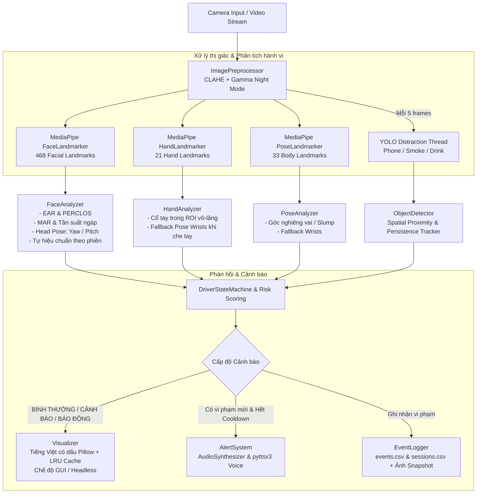
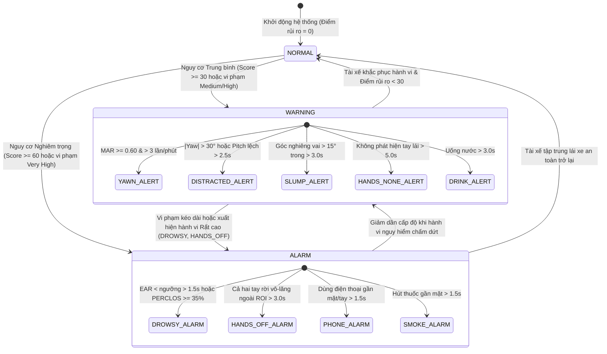
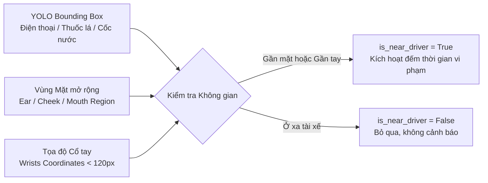
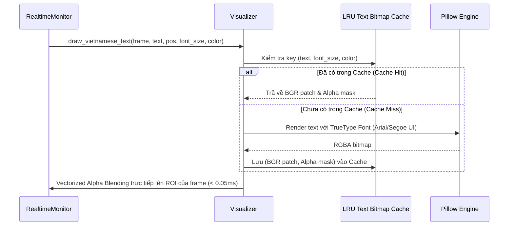

# Sơ đồ Kiến trúc Hệ thống DMS (Driver Monitoring System)

Tài liệu mô tả kiến trúc tổng thể, luồng xử lý đa luồng (multi-threading), máy trạng thái (state machine), và các ràng buộc không gian trong dự án **Hệ thống giám sát trạng thái tài xế (DOAN_CNPM_NHANDIENTAIXE)**.

---

## 1. Kiến trúc Tổng thể (System Pipeline)

Hệ thống được thiết kế theo mô hình xử lý đường ống bất đồng bộ (Asynchronous Multimodal Pipeline), đảm bảo tốc độ khung hình (FPS) ổn định từ 45 - 60 FPS trên máy tính tiêu chuẩn (CPU).

---

## 2. Máy Trạng thái & Tính Điểm Rủi ro (State Machine Lifecycle)

Hệ thống sử dụng bộ máy trạng thái 3 mức với ngưỡng thời gian (persistence timers), bộ đệm chống báo lặp (cooldowns) và điểm rủi ro tổng hợp (Composite Risk Score: 0 - 100):

---

## 3. Ràng buộc Không gian YOLO (Spatial Proximity Constraints)

Để triệt tiêu cảnh báo giả khi phát hiện đồ vật trong xe (ví dụ điện thoại để trên giá đỡ hay chai nước ở hộc để đồ):

---

## 4. Cơ chế Hiển thị Tiếng Việt Có Dấu Tối ưu (Pillow Cache)

